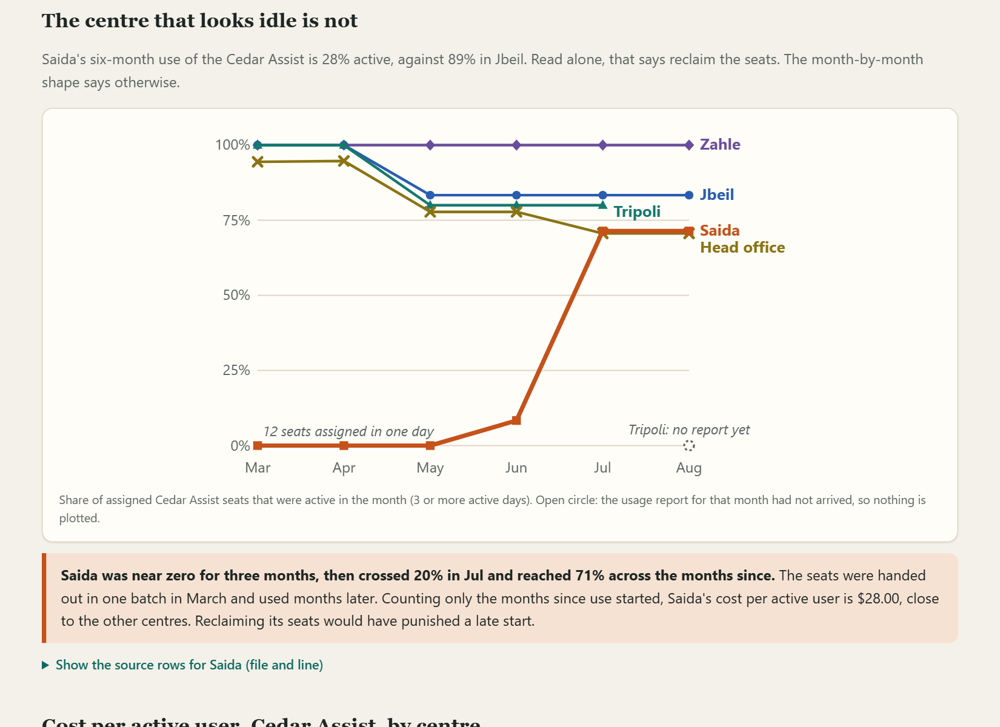
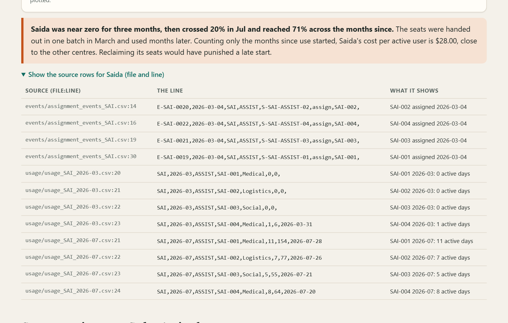
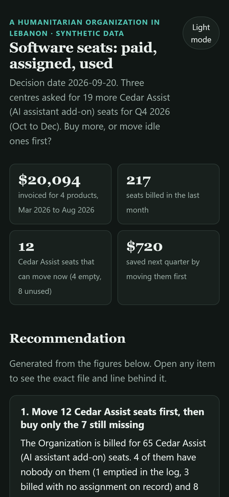

# software-seat-reconciler

Rebuilds, in one command, which paid software seats are assigned and actually used across a humanitarian organization's centres and products, and what the next quarter costs under two options.


All data is synthetic. The organization is not named, and every vendor, product, price and person is invented.

## The need

A humanitarian organization in Lebanon pays per seat per month for several tools: an office suite, an AI assistant add-on, a survey and data-collection tool and an automation platform. Its centres (Zahle, Jbeil, Saida, Tripoli and head office) and departments (Social, Medical, Logistics) share them. Three centres now ask for more AI assistant seats next quarter. The invoice, the assignment log and the usage reports disagree: the invoice bills seats nobody holds, a staff member who moves between centres looks like two seats, one centre's usage report arrives a month late, and one centre looks like it rejects the AI add-on when its training was simply delayed. This project reconciles the three inputs product by product, says what each seat-month is, and shows the file and line behind every recommendation.

## Try it

```
python -m venv .venv
.venv\Scripts\activate          # source .venv/bin/activate on Linux or macOS
pip install -e ".[dev]"
python -m reconciler build      # rebuild everything from data/raw, write build/report.html
python -m reconciler serve      # the same report on http://127.0.0.1:8106/
python -m pytest -q
```

Real output of `build` (also in `docs/sample-output.txt`):

```
raw files: 59 loaded, 0 already loaded, 1 duplicate of an earlier file
reconciled 102 product-centre-months, invoiced $20,094.00, difference $0.00
ASSIST seats: 4 free, 8 reassignment candidates, 7 need more evidence
next quarter new spend: buy $1,140.00, reallocate $420.00
```

It runs offline and needs no API key. The only dependency is DuckDB.

## How it works

Python is a small runner. The logic is SQL, in `reconciler/sql/`, run in order:

| File | What it does |
|---|---|
| `01_raw.sql` | Raw tables, text only, with file name and line number on every row |
| `02_staging.sql` | Types, trimming, de-duplication, and the as-of date (files received later are ignored) |
| `03_intervals.sql` | Assignment history as dated intervals, one row per seat per day |
| `04_spend.sql` | Each seat-month split by day across holders, reconciled to the invoice per product and centre |
| `05_classify.sql` | Each seat-month is active, confirmed inactive, unknown or unassigned |
| `06_candidates.sql` | Reassignment candidates versus seats that need more evidence |
| `07_forecast.sql` | Two options for next quarter for the product under decision, with every assumption in a table |
| `08_evidence.sql` | The source rows (file, line, the line itself) behind each statement |
| `09_summary.sql` | Cost per active user per product and centre, and the all-products summary |

Choices that matter:

- **Product is a dimension.** Every key is (centre, product, month). A seat id belongs to one product, invoices reconcile per product, usage rows join on product, and a seat of one product is never counted as a seat of another. The same person holding four products has four separate seat-months.
- **Idempotent loads.** A file is loaded once, keyed by name and sha256. Importing it again changes nothing. Bytes already seen under another name are recorded as a duplicate and add no rows. A file that changed after import is refused.
- **History is never overwritten.** Events are append-only. An interval is "who held the seat from this event until the seat's next event".
- **Money is integer cents.** A seat-month is split by day with cumulative rounding, so the pieces add up to the invoice exactly.
- **Missing data is not inactivity.** No report, no row for the person, or fewer than 14 days held gives `unknown`. Only a received report that shows too few active days gives `confirmed_inactive`. Seats nobody holds are `unassigned`, a fourth state added because the invoice still bills them.
- **A candidate needs more than one bad month.** Inactive in both of the last two months that have a report, held 60 days or more, and not inside a ramp-up window. Anything weaker goes to "needs more evidence" with the reason.
- **Ramp-up is detected per product and centre, not typed in.** A centre has started a product when 20 percent of its seats are active. The two months after that still count as ramp-up.

The deliberate mess in the data is listed in [docs/data-mess.md](docs/data-mess.md).

## The strongest moment: the centre that looks idle



Over six months Saida uses the AI add-on at 28 percent, against 89 percent in Jbeil, and pays $72.38 per active user per month. Read alone, that says reclaim the seats. The shape says otherwise: all 12 seats were assigned on one day in March, almost nothing happened until June, and from July 71 percent are active. Counting months since it started, Saida pays $28.00 per active user, against $20.43 to $27.59 elsewhere. The median Saida user took 4 months from getting a seat to first real use; in the other centres it took 0. Saida's office suite is 100 percent active over the same months, so the problem is one product's rollout, not the centre. The data fits delayed training, but it does not contain training records (see below).



Every recommendation in the report opens to the file and line it rests on. The report also works on a phone and in dark mode:



## Results

All figures are printed by `python -m reconciler build` on the committed fixtures, decision date 2026-09-20.

| | |
|---|---|
| Invoiced, Mar to Aug 2026, four products | $20,094.00 across 102 product-centre-months, difference to the cent: $0.00 |
| Seats billed in August | 217 (office suite 121, AI assistant 65, survey 25, automation 6) |
| AI seats with nobody on them | 4: 1 emptied in the log, 3 billed with no assignment on record |
| AI reassignment candidates | 8 (head office 4, Jbeil 2, Tripoli 2, Saida 0, Zahle 0) |
| AI seats that need more evidence | 7 |
| Idle seats in the other products | 5 empty and 3 candidates, $128 a month |
| Asked for | 19 AI seats (Zahle 6, Saida 8, Tripoli 5) |
| Option A, buy 19 | $1,140.00 new spend for Q4 2026 |
| Option B, move 12 and buy 7 | $420.00 new spend for Q4 2026 |
| Cost per active AI user per month | $24.91 (A) against $19.05 (B) |

The assumptions behind the forecast (78.7 percent of seats given to requesters become active, prices unchanged, seats move on day 1 and only within the AI product, evidence-needed seats stay put) are printed in the report and stored in `forecast_assumptions`.

### Against the first version

This repository first described an AI assistant in three country offices of an invented NGO. It was re-set on the new scenario with new fixtures, so the old numbers no longer apply. For reference, the old build printed: $19,812.00 invoiced over 18 office-months, 121 seats billed, 8 free, 10 candidates, 9 needing evidence, buy $2,116.80 against reallocate $540.00 (a $1,577 difference), and its late-onboarding office was 35 percent active at $85.22 per active user, falling to $34.55 once counted from July. New: $20,094.00 over 102 product-centre-months, 217 seats billed, 8 AI candidates, 7 needing evidence, buy $1,140.00 against reallocate $420.00 (a $720 difference), and Saida at 28 percent and $72.38, falling to $28.00. The two datasets are different, so these are not a before and after of the same thing.

### Tests

The 23 tests (`python -m pytest -q`) cover: spend reconciles to the invoice to the cent, checked against an independent parse of the raw CSVs, in total and per product; every seat-month adds to one seat price; a seat reassigned inside a centre is one seat (16 and 14 days split 1067 and 933 cents); a staff member who moves between centres is not double counted; a seat id never belongs to two products and one person with four products keeps four seat-months; the same person is active on one product and inactive on another; the forecast pool holds only the product under decision; a hand-built case prorates 10 of 31 days to 968 cents with no cent lost; a repeated import gives identical table fingerprints; a duplicate invoice file adds nothing; a changed file is refused; the generator is deterministic; missing usage is `unknown` and never `confirmed_inactive`; a late report changes the answer; Saida is held back, not reclaimed; the report is self-contained.

## Where it fails

- **No sign-in data, no reason.** A silent seat could be a person on leave, one who left, one working offline in the field, or one who does not want the tool. The usage report cannot tell these apart, so "no real use" is a prompt to ask, not a verdict.
- **Saida's explanation is inferred from a shape.** The pipeline sees a bulk assignment followed by a step change. Nothing in the inputs says training was delayed. A one-off campaign would look the same.
- **The answer depends on a late file.** On the default date Tripoli's August report has not arrived and 2 Tripoli AI seats are candidates. With `--as-of 2026-10-10` it has arrived, TRI-002 turns out to have come back in August, and the count falls to 1. Reclaiming on the early data would have taken a seat from someone using it.
- **The threshold cuts both ways, and at 1 day it breaks.** From `python -m reconciler sensitivity`: at 2 to 4 active days the AI candidates are stable (Jbeil 2, Tripoli 2, head office 4). At 1 active day, people who open the tool once a month count as active, so head office and Tripoli drop to 0 candidates, and Saida's ramp-up window ends earlier, so 2 idle Saida seats wrongly become candidates. At 6 days needs-more-evidence grows from 7 to 13.

```
as_of       threshold  ZAH  JBE  SAI  TRI   HQ  needs_evidence
2026-09-20          1    0    2    2    0    0              10
2026-09-20          3    0    2    0    2    4               7
2026-09-20          6    0    2    0    2    5              13
2026-10-10          3    0    2    0    1    4               8
```

## What I would add next

- Read real licence audit logs and usage exports instead of synthetic files, and add sign-in data to separate "on leave" from "does not use it".
- An LLM pass that drafts the plain-language recommendation from the figures for a reviewer to edit, with the numbers still computed in SQL.

## Licence

MIT. See `LICENSE`.
