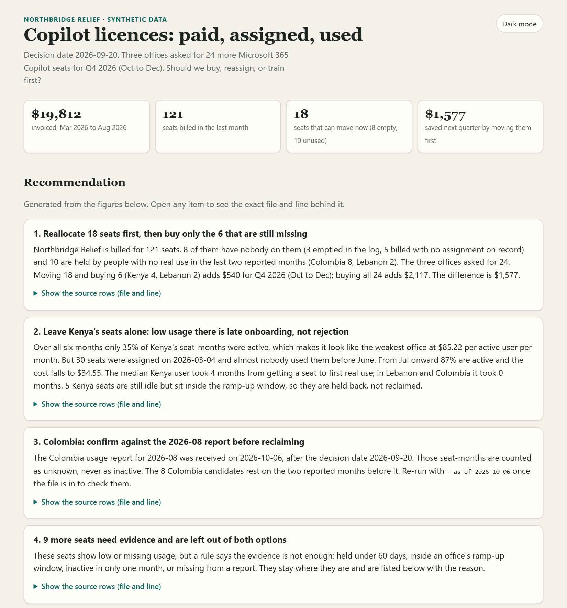
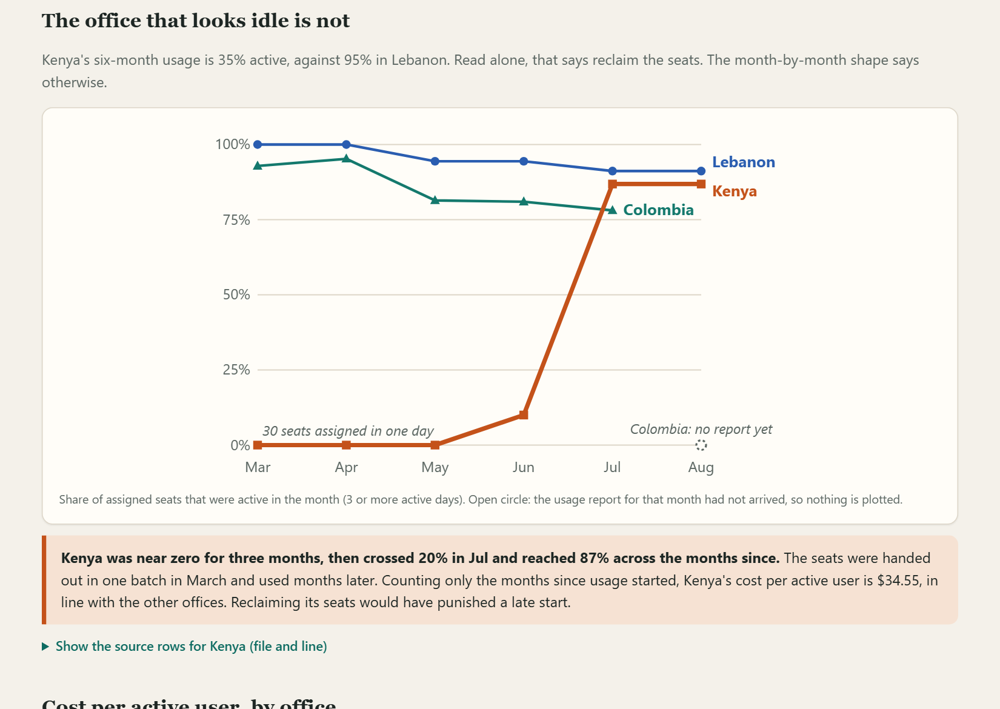
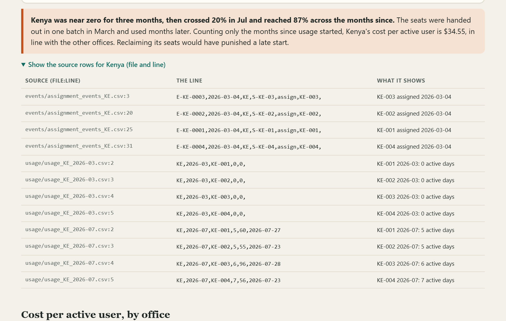

# copilot-license-reconciler

Rebuilds, in one command, which AI licences are paid for, assigned and actually used, and what the next quarter costs under two options.



All data is synthetic (a made-up NGO, Northbridge Relief, with offices in Lebanon, Kenya and Colombia).

## The need

Three country offices ask for more Microsoft 365 Copilot seats next quarter. Should the organisation buy more, move seats that sit idle, or train people first? The inputs disagree: the invoice bills seats the assignment log never mentions, a seat that changes hands mid-month looks like two seats, one usage report arrives a month late, and one office looks almost unused because its onboarding started late. This project reconciles the three inputs, says what each seat-month is, and shows the evidence behind each recommendation.

## Try it

```
python -m venv .venv
.venv\Scripts\activate          # source .venv/bin/activate on Linux or macOS
pip install -e ".[dev]"
python -m reconciler build      # rebuild everything from data/raw, write build/report.html
python -m reconciler serve      # the same report on http://127.0.0.1:8106/
python -m pytest -q
```

Real output of `build` (also in `docs/sample-output.txt`):

```
raw files: 39 loaded, 0 already loaded, 1 duplicate of an earlier file
reconciled 18 office-months, invoiced $19,812.00, difference $0.00
seats: 8 free, 10 reassignment candidates, 9 need more evidence
next quarter new spend: buy $2,116.80, reallocate $540.00
```

It runs offline and needs no API key. The only dependency is DuckDB.

## How it works

Python is a small runner. The logic is SQL, in `reconciler/sql/`, run in order:

| File | What it does |
|---|---|
| `01_raw.sql` | Raw tables, text only, with file name and line number on every row |
| `02_staging.sql` | Types, trimming, de-duplication, and the as-of date (files received later are ignored) |
| `03_intervals.sql` | Assignment history as dated intervals, one row per seat per day |
| `04_spend.sql` | Each seat-month split by day across holders, reconciled to the invoice |
| `05_classify.sql` | Each seat-month is active, confirmed inactive, unknown or unassigned |
| `06_candidates.sql` | Reassignment candidates versus seats that need more evidence |
| `07_forecast.sql` | Two options for next quarter, with every assumption in a table |
| `08_evidence.sql` | The source rows (file, line, the line itself) behind each statement |
| `09_summary.sql` | Cost per active user per office |

Choices that matter:

- **Idempotent loads.** A file is loaded once, keyed by name and sha256. Importing it again changes nothing. Bytes already seen under another name are recorded as a duplicate and add no rows. A file that changed after import is refused.
- **History is never overwritten.** Events are append-only. An interval is "who held the seat from this event until the seat's next event".
- **Money is integer cents.** A seat-month is split by day with cumulative rounding, so the pieces add up to the invoice exactly.
- **Missing data is not inactivity.** No report, no row for the user, or fewer than 14 days held gives `unknown`. Only a received report that shows too few active days gives `confirmed_inactive`. Seats nobody holds are `unassigned`, a fourth state added because the invoice still bills them.
- **A candidate needs more than one bad month.** Inactive in both of the last two months that have a report, held 60 days or more, and not inside an office's ramp-up window. Anything weaker goes to "needs more evidence" with the reason.
- **Ramp-up is detected, not typed in.** An office has started when 20 percent of its seats are active. The two months after that still count as ramp-up.

The deliberate mess in the data is listed in [docs/data-mess.md](docs/data-mess.md).

## The strongest moment: the office that looks idle



Over six months Kenya is 35 percent active against 95 percent in Lebanon, and costs $85.22 per active user per month. Read alone, that says reclaim the seats. The shape says otherwise: 30 seats were assigned on one day in March, almost nothing happened until June, and from July 87 percent are active. Counting months since it started, Kenya costs $34.55 per active user, the same as Lebanon ($33.93) and Colombia ($34.50). The median Kenya user took 4 months from getting a seat to first real use; elsewhere it took 0.



Every recommendation in the report opens to the file and line it rests on. The report also works on a phone and in dark mode:


## Results

All figures are printed by `python -m reconciler build` on the committed fixtures, decision date 2026-09-20.

| | |
|---|---|
| Invoiced, Mar to Aug 2026 | $19,812.00 across 18 office-months, difference to the cent: $0.00 |
| Seats billed, August | 121 |
| Free seats (nobody on them) | 8: 3 emptied in the log, 5 billed with no assignment on record |
| Reassignment candidates | 10 (Colombia 8, Lebanon 2, Kenya 0) |
| Need more evidence | 9 |
| Asked for | 24 seats (Lebanon 8, Kenya 10, Colombia 6) |
| Option A, buy 24 | $2,116.80 new spend for Q4 2026 |
| Option B, move 18 and buy 6 | $540.00 new spend for Q4 2026 |
| Cost per active user per month | $36.32 (A) against $31.80 (B) |

The assumptions behind the forecast (85 percent of seats given to requesters become active, prices unchanged, seats move on day 1, evidence-needed seats stay put) are printed in the report and stored in `forecast_assumptions`.

The 19 tests (`python -m pytest -q`) cover: spend reconciles to the invoice to the cent, checked against an independent parse of the raw CSVs; every seat-month adds to one seat price; a reassigned seat is one seat and its pieces add to 31 days; a hand-built case prorates 10 of 31 days to 968 cents with no cent lost; a repeated import gives identical table fingerprints; a duplicate invoice file adds nothing; a changed file is refused; the generator is deterministic; missing usage is `unknown` and never `confirmed_inactive`; a late report changes the answer; Kenya is held back, not reclaimed; the report is self-contained.

## Where it fails

- **No sign-in data, no reason.** A silent seat could be a person on leave, one who left, one working offline in the field, or one who does not want the tool. The usage report cannot tell these apart, so "no real use" is a prompt to ask, not a verdict.
- **Kenya's explanation is inferred from a shape.** The pipeline sees a bulk assignment followed by a step change. Nothing in the inputs says training started in June. A one-off campaign would look the same.
- **The answer depends on a late file.** On the default date Colombia's August report has not arrived and 8 Colombian seats are candidates. With `--as-of 2026-10-10` it has arrived, CO-033 turns out to have come back in August, and the count falls to 7. Reclaiming on the early data would have taken a seat from someone using it.
- **The rules are choices, and one choice breaks Kenya.** From `python -m reconciler sensitivity`: at a threshold of 2 to 4 active days the candidates are stable (Lebanon 2, Kenya 0, Colombia 8). At 1 active day Kenya's ramp-up window ends earlier, and 2 Kenyan seats that are still idle in a ramping office become candidates. A threshold of 6 pushes needs-more-evidence from 9 to 19.

```
as_of       threshold  LB  KE  CO  needs_evidence
2026-09-20          1   1   2   6               8
2026-09-20          3   2   0   8               9
2026-09-20          6   2   0   8              19
2026-10-10          3   2   0   7              10
```

## What I would add next

- Read the real Microsoft 365 usage report and licence audit log exports instead of synthetic files, and add sign-in data to separate "on leave" from "does not use it".
- An LLM pass that drafts the plain-language recommendation from the figures for a reviewer to edit, with the numbers still computed in SQL.

## Licence

MIT. See `LICENSE`.
